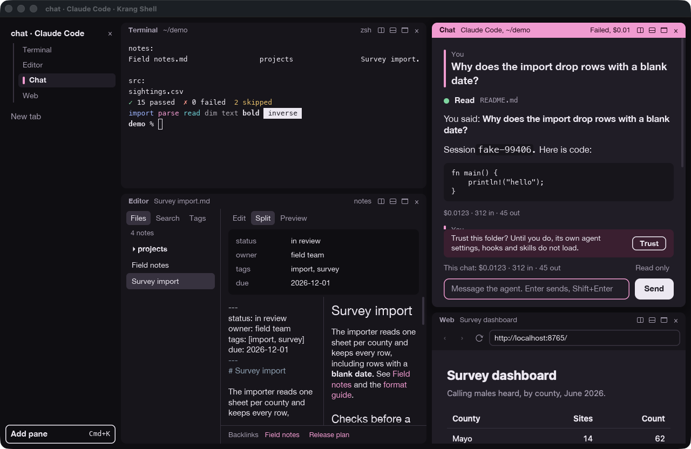
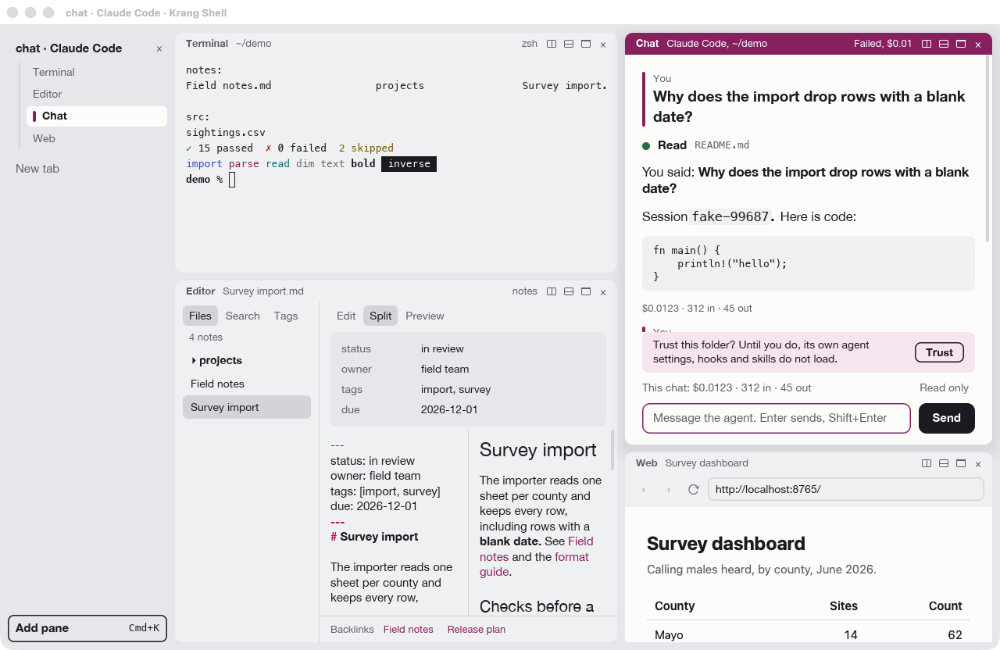
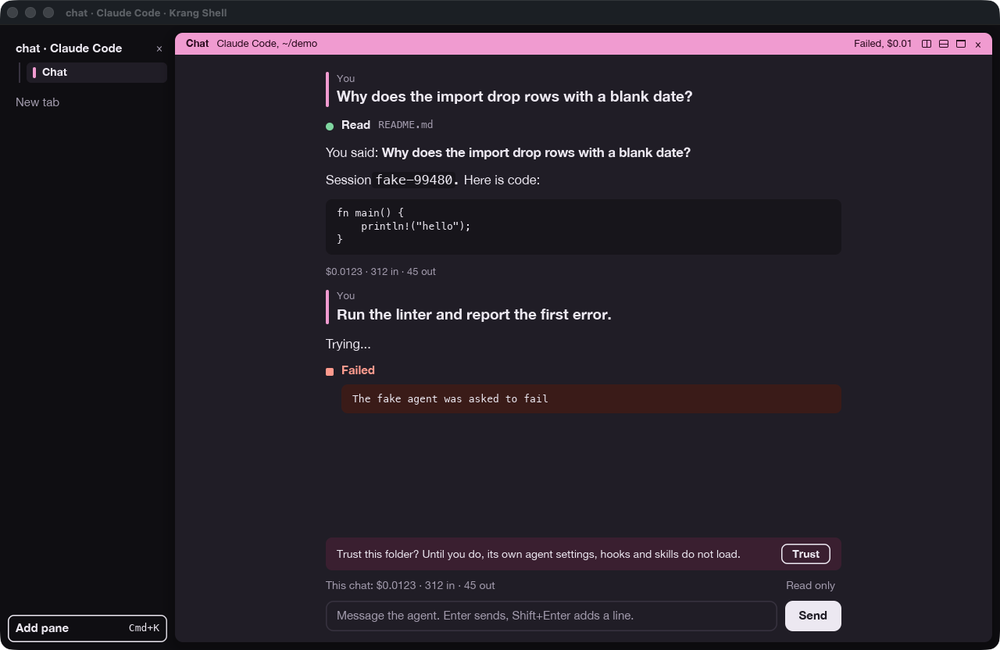
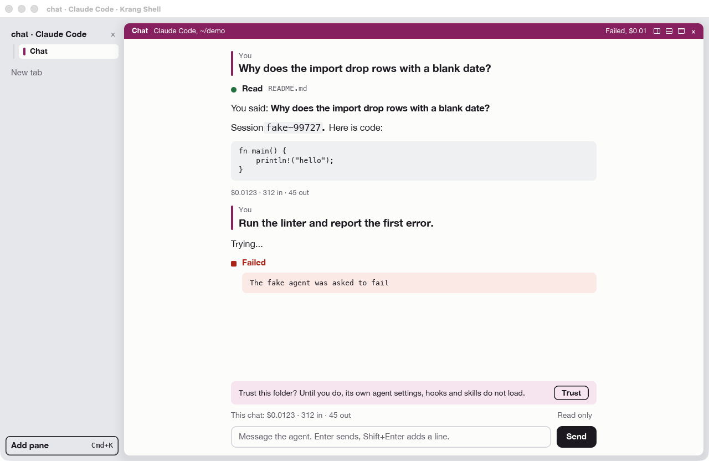
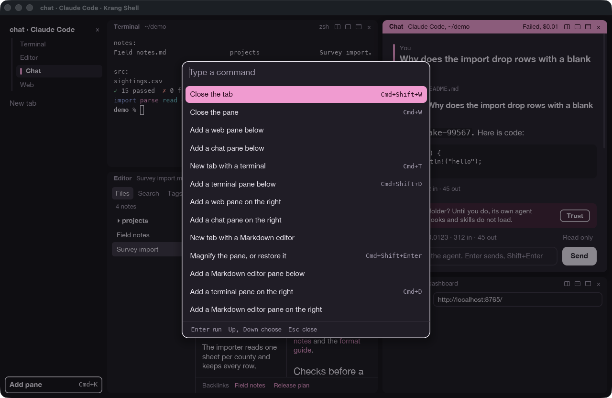
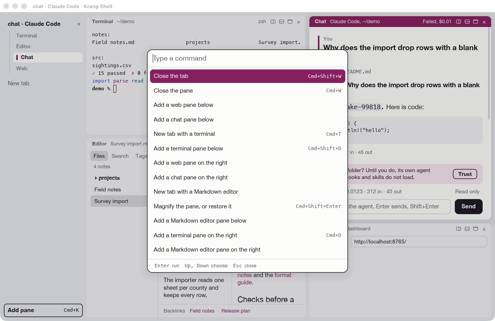
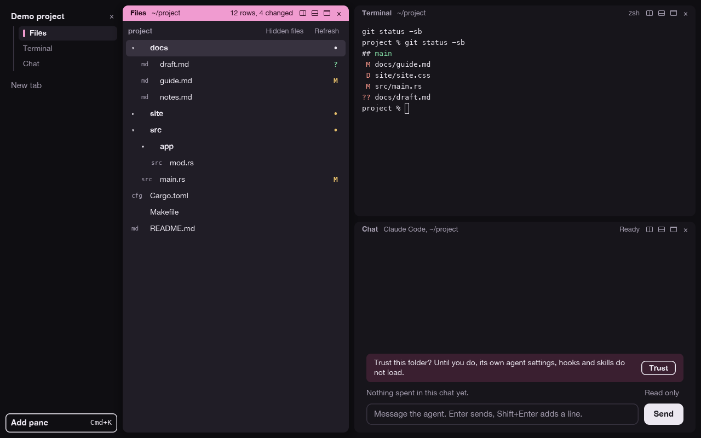
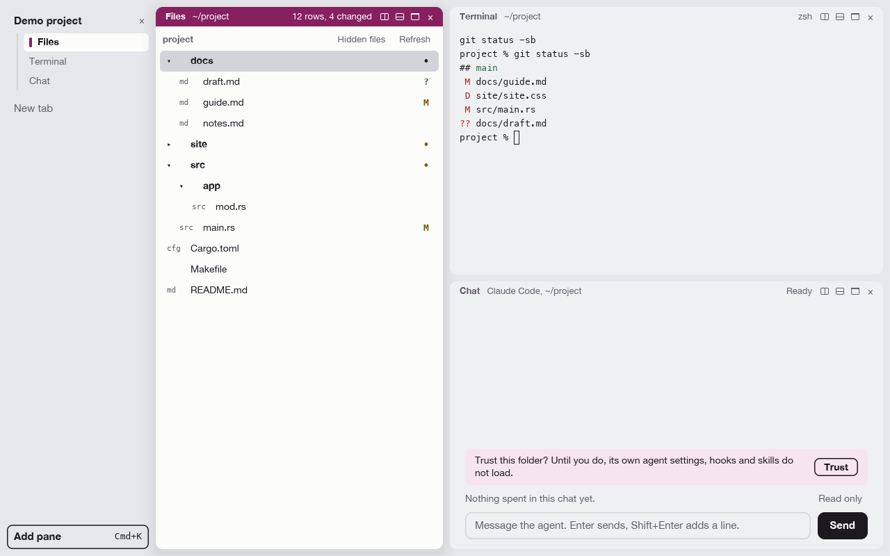
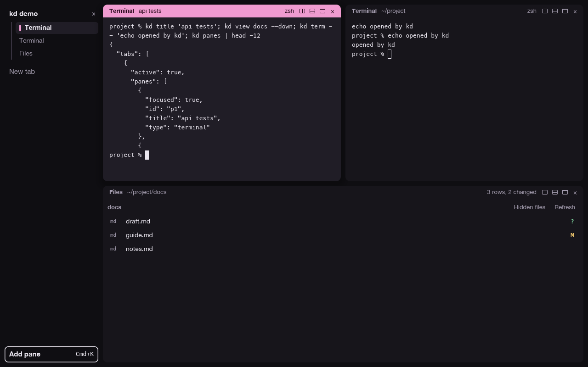

# Krang Shell: a native spike on iced

A native version of the Krang Desktop shell, written in Rust on
[iced](https://github.com/iced-rs/iced) 0.14, to find out whether moving off
Tauri and React is worth it. It has the shell (tabs, tiling panes, session
restore, layout files), five panes (terminal, chat, web, files and a
Markdown editor over a vault) and `kd`, the tool a program in a terminal
pane drives the app with. It is a spike: macOS is the target, and the
results are in [RESULTS.md](RESULTS.md).

## How it looks

Tabs sit in a rail on the left, and the shown tab lists its panes. Each pane
is a rounded surface. The focused pane is brighter, and its status line is
filled with the accent colour.

| Dark | Light |
| ---- | ----- |
|  |  |
|  |  |
|  |  |

The app follows the system's light or dark appearance and changes with it
while running. Dark is used when the system does not say.
`KRANG_THEME=light` or `KRANG_THEME=dark` fixes the choice.

Every colour, text size, space, radius and font family is in `src/style`.
`tokens.rs` holds the colours for both modes and `widget.rs` holds one style
per widget role, so a different look is a change to that folder alone. The
terminal's 16 colours come from the same tokens. Tests check that every text
colour has at least 4.5:1 contrast on each background it is drawn on.

Text is set in Helvetica Neue and Menlo, which macOS ships. The family names
are two lists in `src/style/mod.rs`.

To take these screenshots again, run the `showcase` self-test (see
`src/app/selftest.rs`) with `KRANG_WINDOW_SIZE=1280x800`, and capture the
window with `screencapture -l`.

`KRANG_SELFTEST_SHOT=<file.bmp>` makes any self-test write what the window
has drawn just before it exits. The app draws the picture itself, so this
works with the screen locked, where `screencapture` does not. It leaves out
the text of an editor and every web view. The files and `kd` pictures below
were made this way, with `HOME` set to a demo folder.

## Build and run on macOS

You need Rust 1.90 or later (`rustup default stable`).

```sh
cd spikes/iced-shell
cargo run --release
```

Open a layout file, as the current app does:

```sh
cargo run --release -- --layout ../../apps/desktop/examples/demo.toml
```

Build an app bundle, which the Dock and the app switcher need:

```sh
scripts/bundle-macos.sh
open "target/release/Krang Shell.app"
```

### Open a window without taking the keyboard

```sh
KRANG_QUIET=1 "target/release/Krang Shell.app/Contents/MacOS/krang-shell"
```

With `KRANG_QUIET=1` the app does not activate itself at launch, so the app
you are typing in keeps the keyboard; the window opens behind it. Click the
window to use it. This is a six-line patch to the vendored `iced_winit`, see
[vendor/README.md](vendor/README.md). `open -a` activates an app on its own,
so start the binary inside the bundle directly as above.

### Chat agents

A chat pane talks to one of four agents. The palette has an "Add a ... chat
pane" command for each, `kd chat --agent` and layouts take the lowercase
name, and the agent's name in the pane's footer switches an empty chat to
the next one.

| Agent       | Name     | Runs                                            | Read only / edit                  |
| ----------- | -------- | ----------------------------------------------- | --------------------------------- |
| Claude Code | `claude` | `claude -p --output-format stream-json ...`     | `--permission-mode plan` / `acceptEdits` |
| Codex       | `codex`  | `codex exec --json ...`                         | `-s read-only` / `workspace-write` |
| Gemini      | `gemini` | `gemini --output-format stream-json ...`        | `--approval-mode plan` / `auto_edit` |
| Local       | `local`  | this app's own binary as `krang-shell --local-agent` | text only, no tools          |

Each one keeps its session between messages: Claude and Gemini with
`--resume`, Codex with `exec resume`. No mode turns off an agent's own
permission checks, so nothing runs with `yolo` or a skipped sandbox.

Gemini reads the prompt on standard input and runs headless. Gemini CLI
refuses to run headless in a folder it has not trusted, so until you press
Trust in the pane it gets no `--skip-trust`, and a run there fails unless
the folder is already trusted in Gemini itself.

Local sends the conversation to Ollama's `/api/chat` with streaming on,
over plain http with no extra dependency. It costs nothing, and the pane
shows its tokens at $0. It keeps each conversation in
`local-chats/<session>.json` in the state folder below. If Ollama is not
listening, the chat shows "Ollama is not running at ..." as a failed run.

| Variable            | What it sets                                  | Default                  |
| ------------------- | --------------------------------------------- | ------------------------ |
| `OLLAMA_HOST`       | Where Ollama listens, `host:port` or `http://host:port` | `http://127.0.0.1:11434` |
| `KRANG_LOCAL_MODEL` | The Ollama model the Local agent uses         | `qwen3.5:9b-q8_0`        |
| `KRANG_CLAUDE_BIN`, `KRANG_CODEX_BIN`, `KRANG_GEMINI_BIN`, `KRANG_LOCAL_BIN` | Another program to run as that agent, such as the fake agent | the first match on the PATH, or this app for Local |

A thinking model such as the default thinks before it writes, and the pane
shows only the answer, so the first words can take a while.

### Chat without an account

The chat pane runs the `claude` or `codex` command it finds on the PATH.
To try it without either, point it at the fake agent:

```sh
KRANG_CLAUDE_BIN=$PWD/scripts/fake-agent KRANG_CODEX_BIN=$PWD/scripts/fake-agent cargo run --release
```

The fake agent streams a Markdown reply with a tool call, cost and tokens. A
message containing `slow` streams for ten seconds (try Stop), `error` fails
with an error result, and `crash` exits with a message on standard error.

### Where things are kept

The workspace (tabs and their names, panes, each pane's directory, note,
URL, chat transcript and open folders) is saved to `~/Library/Application
Support/ie.cteic.krang-shell/workspace.json` as it changes and when the
window closes, and comes back at the next start. `--fresh` starts empty.
`KRANG_STATE_DIR` moves the folder, which the tests use. A window opened
with `--layout` does not save, as in the current app.

Layouts saved from the app go in the `layouts` folder beside that file.

A new editor pane opens the folder in `KRANG_VAULT`, or else the folder the
app was started in.

## Tabs

A tab shows the title of the pane that has the keyboard until you name it.

| To | Do this |
| -- | ------- |
| Name a tab | Double-click it, or run **Rename the tab** from the palette. Enter keeps the name, Escape drops it. An empty name gives the tab back to its panes. |
| Move a tab | Drag it over another tab, or run **Move the tab left** or **Move the tab right**. |
| Save a tab as a layout | Run **Save the tab as a layout**. The file is `layouts/<name>.toml`, where the name is the tab's name in lower case with dashes. A layout saved under the same name before is replaced. |
| Open a saved layout | `krang-shell --layout <name>`, for example `--layout api-review`. |

A saved layout holds where the panes go and what they open. It leaves out
what a pane has done since: a chat's transcript and trust, the folders open
in a files pane, and whether a pane is magnified.

## Shortcuts

Cmd is the Super key on Linux.

| Keys                     | Action                                         |
| ------------------------ | ---------------------------------------------- |
| Cmd+T                    | New tab                                        |
| Cmd+D, Cmd+Shift+D       | Split right, split down (a new terminal)       |
| Cmd+K or Cmd+Shift+P     | Command palette: add a pane of any kind        |
| Cmd+Shift+Enter          | Magnify the pane, or restore it                |
| Cmd+] and Cmd+[          | Next and previous pane                         |
| Cmd+Shift+] and Cmd+Shift+[ | Next and previous tab                       |
| Cmd+1 to Cmd+9           | Go to a tab                                    |
| Cmd+W, Cmd+Shift+W       | Close the pane, close the tab                  |
| Escape                   | Close the palette, switcher, find or completion |
| Shift+Enter in a terminal | A new line without sending, for agent prompts |
| Cmd+C, Cmd+V in a terminal | Copy the selection, paste                    |
| Cmd+O                    | Editor: open a note by name                    |
| Cmd+F, Cmd+Shift+F       | Editor: find in the note, search the vault     |
| Cmd+E                    | Editor: edit, split, preview                   |
| Cmd+Z, Cmd+Shift+Z       | Editor: undo, redo                             |
| Cmd+S                    | Editor: save now (it also saves on a pause)    |
| Cmd+Enter                | Editor: follow the wikilink at the cursor      |
| Cmd+L, Cmd+R             | Web: go to the address bar, reload             |
| Up, Down, Page Up, Page Down, Home, End | Files: move the selection        |
| Right, Left              | Files: open a folder or step into it; close it or go to its parent |
| Enter                    | Files: open the file, or open and close the folder |
| Cmd+R                    | Files: read the folder again                   |
| Cmd+Shift+.              | Files: show or hide hidden files               |

Drag a pane's status line onto another pane to move it. Drag a divider to
resize. The same shortcuts work while a web page has the keyboard.

## The files pane

A folder as a tree. Add one from the palette (**Add a files pane**), with
`kd view <folder>`, or with `type = "files"` in a layout.

| Dark | Light |
| ---- | ----- |
|  |  |

- A folder is read when you open it, and not before. The folder, the open
  folders and the hidden files choice come back with the saved workspace.
- Each file has a short marker for its kind: `md`, `web`, `src`, `cfg`,
  `img` or `txt`. Files whose names start with a dot are hidden until you
  turn **Hidden files** on.
- Inside a git repository each changed path shows git's letter: `M`
  modified, `A` added, `D` deleted, `R` renamed, `?` untracked, `U` in
  conflict. A folder with a change somewhere inside shows a dot. The app
  runs one `git status` per refresh, off the window's thread, and never
  takes git's index lock.
- A file opens by its type. An `.html` or `.htm` file opens in a web pane.
  Anything else opens in an editor: a Markdown note with the editor's
  Markdown tools, another file as text highlighted by its extension. A pane
  of the right kind in the same tab is used again; when there is none, one
  opens to the right of the files.
- The pane reads its folder again when it gets the keyboard, on Cmd+R, and
  with its **Refresh** button. It does not watch the disk: see RESULTS.md.

## The usage pane

Each reply a chat pane finishes is written to `ledger.jsonl`, beside the
saved workspace: the agent, the folder, the tokens in and out, and the cost
when the agent reports one. The usage pane (Cmd+K, "Add a usage pane") sums
the ledger by agent for the last 24 hours, the last 7 days and all time, and
says what share of the tokens went to agents that cost nothing. It reads the
ledger again whenever a chat reply ends.

Codex reports tokens but no price, so its cost shows as unknown and its
tokens never count as free.

## kd: drive the app from a terminal pane

`kd` is a command for programs that run in a terminal pane. A script or a
coding agent uses it to open a file beside itself, open a web page, or set
its own pane's title. It is the app's binary under another name, so it
always matches the app.



| Command | What it does | Example |
| ------- | ------------ | ------- |
| `kd view <path> [--down]` | Opens a file in an editor, or a folder in a files pane | `kd view src/main.rs` |
| `kd web <url-or-path> [--down]` | Opens a web pane | `kd web http://localhost:3000` |
| `kd term [dir] [--down] [-- command...]` | Opens a terminal, and types a first command into it | `kd term api -- pnpm dev` |
| `kd chat [--agent claude\|codex] [dir] [--down]` | Opens a chat pane | `kd chat --agent codex` |
| `kd title <text>`, `kd title --clear` | Sets or clears this pane's title | `kd title "api tests"` |
| `kd panes` | Prints the window's tabs and panes as JSON | `kd panes` |
| `kd mcp` | Serves these commands as MCP tools on standard input and output | `claude mcp add krang -- kd mcp` |

- A new pane opens to the right of the pane that called, or below it with
  `--down`. The keyboard stays where it was.
- Relative paths are taken from the directory `kd` runs in.
- `kd web` takes an argument with `://` in it as a URL. Anything else must
  be a file on disk. Write `http://localhost:3000`, not `localhost:3000`.
- `kd term -- 'pnpm test && pnpm build'` types the one argument as written.
  With several arguments, `kd` quotes each one.
- Put `--` before text that starts with a dash: `kd title -- --draft`.
- Exit codes: `0` done, `1` failed with the reason on standard error, `2`
  the command line was wrong.

`kd panes` prints:

```json
{
  "tabs": [
    {
      "active": true,
      "panes": [{ "focused": true, "id": "p1", "title": "api tests", "type": "terminal" }],
      "title": "api tests"
    }
  ]
}
```

### Use kd from any agent

`kd mcp` is an MCP server. A coding agent started in a terminal pane gets
the tools `kd_view`, `kd_web`, `kd_term`, `kd_chat`, `kd_title` and
`kd_panes`, with the same arguments as the commands above. Register it
once.

Claude Code:

```sh
claude mcp add krang -- kd mcp
```

Codex, in `~/.codex/config.toml`:

```toml
[mcp_servers.krang]
command = "kd"
args = ["mcp"]
```

Gemini CLI, in `.gemini/settings.json` for one project or
`~/.gemini/settings.json` for all:

```json
{
  "mcpServers": {
    "krang": { "command": "kd", "args": ["mcp"] }
  }
}
```

- The agent finds `kd` on the pane's `PATH`.
- Outside a pane, every tool call fails with a message that says so. The
  server keeps running.
- A chat pane's agent gets none of the pane's variables, so the tools fail
  there too.

The app sets these in every terminal pane's shell:

| Variable | Value |
| -------- | ----- |
| `KRANG_SOCKET` | Path of the socket the app listens on |
| `KRANG_PANE_ID` | Id of the pane, such as `p3` |
| `KRANG_PANE_TOKEN` | A secret made for this pane when its shell started |
| `KRANG_CLI` | Full path of `kd` |

The app also puts `kd`'s folder on the pane's `PATH`. A shell profile that
sets `PATH` from scratch drops it; then use `"$KRANG_CLI"`.

How a request is checked:

- The socket is `kd-<pid>.sock` in `$XDG_RUNTIME_DIR/krang-shell` where the
  system gives a runtime directory, or else in `run` in the app's own
  folder, or else in a folder under the temporary directory when that path
  is too long for a socket. The folder is mode 700 and must belong to the
  user; the socket is mode 600.
- The app answers only a process that runs as the same user.
- A request is one line of JSON, at most 64 KiB, read with a five second
  limit. The app answers with one line.
- A request names its pane and carries that pane's secret. The app refuses
  one that does not, with the same words whether the pane is unknown or
  the secret is wrong. One pane's secret does not speak for another, and a
  secret stops working when its pane closes.
- A chat pane's agent gets none of these variables.

The secret is in the pane's environment, so every program started in that
pane can read it. That is what lets a script use `kd`. It does not protect
against a program the person runs in the pane on purpose.

## Layout files

The same TOML the current app reads. One file is one tab.

```toml
title = "my project"

[[panes]]
id = "root"
split = "vertical"          # side by side; "horizontal" stacks
children = ["shell", "notes"]
sizes = [2, 1]              # optional relative sizes

[[panes]]
id = "shell"                # no type means a terminal
directory = "~/src/project"
is_focused = true
commands = ["git status -sb"]

[[panes]]
id = "notes"
type = "editor"
path = "~/src/project/README.md"
mode = "split"              # edit, split or preview
```

| Type       | Fields                                      | In this spike                       |
| ---------- | ------------------------------------------- | ----------------------------------- |
| `terminal` | `directory`, `commands`                     | as in the app                       |
| `editor`   | `path`, `mode`, `vault`                     | the vault is `vault`, or the nearest folder above the note with `.obsidian`, or the note's folder |
| `web`      | `url` (URL, `localhost:3000` or a path)     | as in the app                       |
| `chat`     | `agent`, `directory`, `mode`                | as in the app                       |
| `files`    | `directory`, `hidden`                       | the files pane; `hidden = true` shows hidden files |
| `graph`    | `directory`                                 | opens the folder as a vault in an editor pane; there is no graph pane |

Every pane also takes `title` and `is_focused`.

## Checks and benchmarks

```sh
cargo fmt --check
cargo clippy --all-targets -- -D warnings
cargo test
./bench.sh                  # Linux: prints the table in RESULTS.md
```

`KRANG_SELFTEST` runs a scripted scenario with no keyboard or person and
prints `name value` lines; `src/app/selftest.rs` lists them.
`scripts/make-test-vault.py <dir>` writes the 5,000-note test vault.

## Layout of the code

```text
src/term      terminal: pty session, event queue, snapshot, widget, key encoding
src/chat      agent stream adapters, transcript, process runner
src/vault     vault index, wikilinks, tags, frontmatter, search, fuzzy match
src/web       address handling, the localfile scheme, the web view host
src/files     the folder tree, file kinds, git status
src/kd        the pane tool: protocol, socket server, client, command line
src/shell     layout files, saved layouts, tab order and the saved workspace
src/app       the window, panes, palette, shortcuts and the self-test
src/style     design tokens for dark and light, and one style per widget role
vendor        iced_winit with the quiet-launch patch
```
