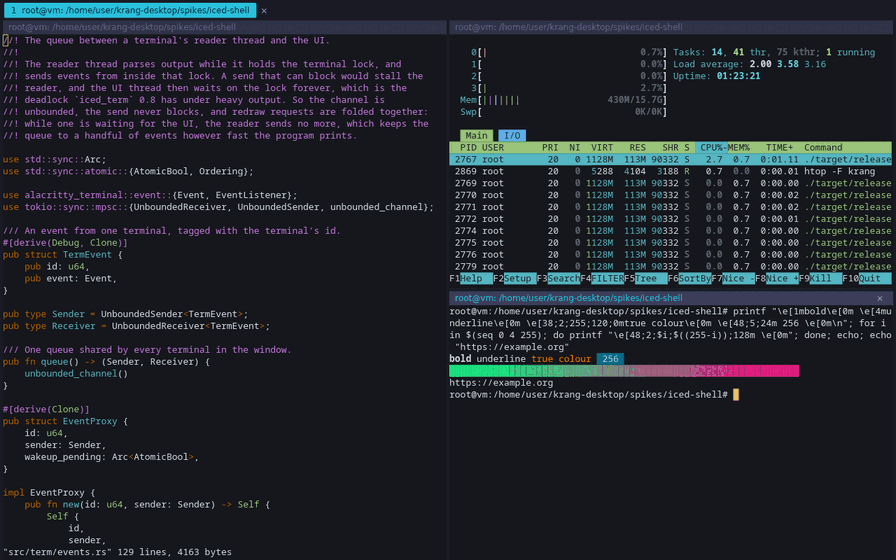
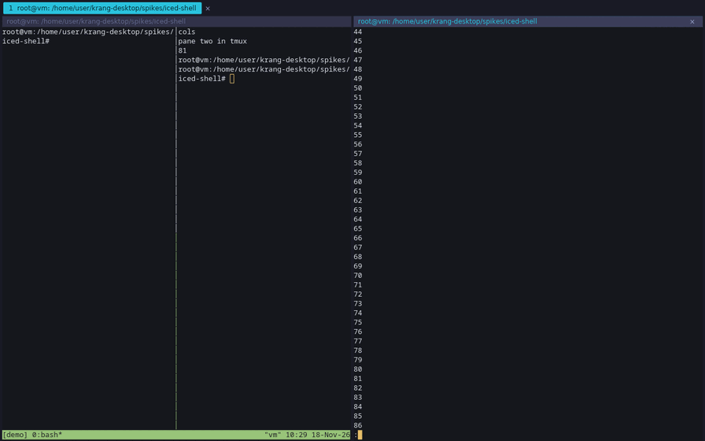
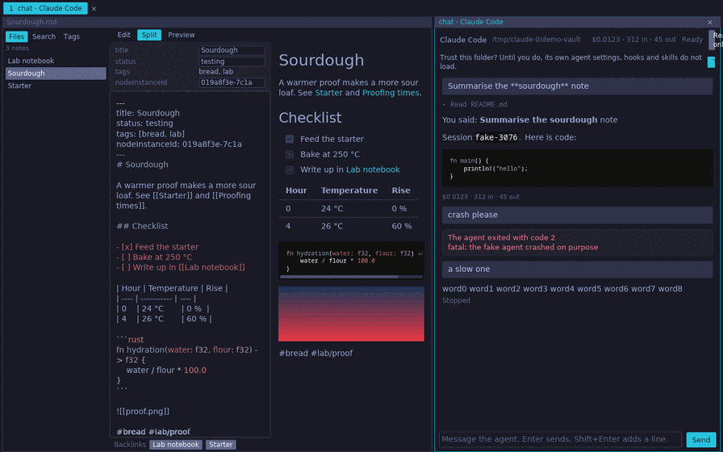
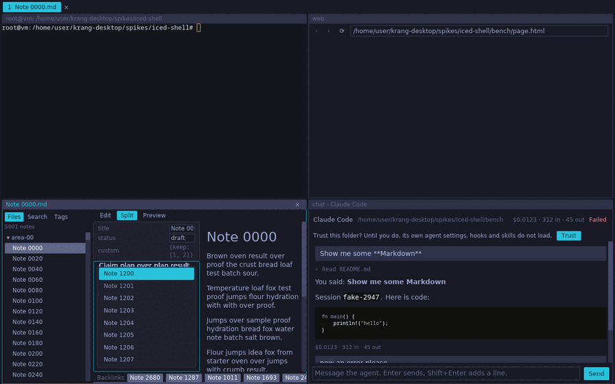
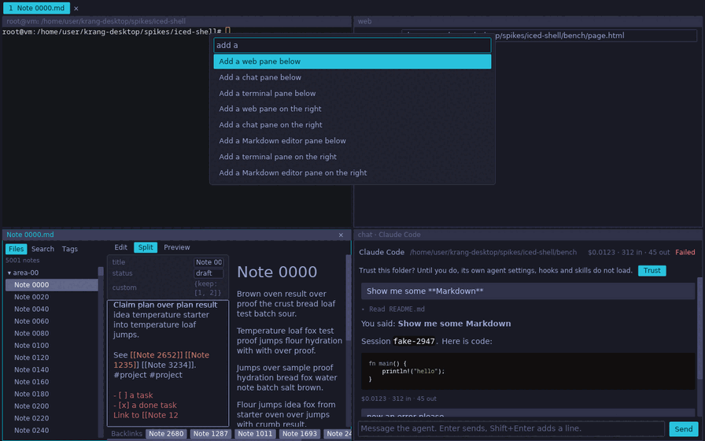

# Results: a native shell on iced

Spike date: 18 November 2026. Everything measured here ran on a shared
Linux cloud machine (4 cores, no GPU) under Xvfb with iced's software
renderer (tiny-skia). The product target is macOS. None of these numbers
can be compared with the Mac table in the brief, and every claim about
macOS behaviour below is unverified unless it says the macOS CI job ran it.

## Verdict

**Yes for the terminal and the shell, no for the web pane, and only with
patches for the editor.**

- **Terminal: much better.** A terminal built directly on
  `alacritty_terminal` runs vim, htop, tmux and less correctly, keeps memory
  flat under four flooding terminals (191 MB for the whole app, measured),
  answers a quiet terminal in 30 ms median while the others flood, and puts
  a typed key on screen in 4.7 ms median. The current app's terminal grew to
  12.1 GB in 20 s under the same flood on the owner's Mac. This alone is the
  strongest reason to move.
- **Shell: as good, and lighter.** Tiling, tabs, palette, layout files and
  session restore were quick to build on iced's `pane_grid`. Idle CPU is 0%
  with no polling. The app's own memory is 142 MB with one pane of each kind.
- **Chat: no harder than in React.** The stream adapters and transcript
  rules port one to one, with tests. iced's Markdown widget renders replies,
  code highlighting included.
- **Markdown editor: workable, but iced's text editor is thin.** It has no
  undo (written here), shaped every line of a new text up front (2.7 s for
  50,000 lines, fixed with a one-line patch to 20 ms), and the preview has
  no virtualisation, so a very long note previews its first 600 blocks.
  Obsidian's live preview in one pane would need a custom editor widget.
- **Web pane: the weak point, and unproven.** A system web view as a child
  view works in principle through `wry`, and pages load here (load events
  and titles arrive), but on Linux WebKitGTK paints black inside the iced
  window, and nothing about WKWebView on macOS has run yet. The z-order
  rule (nothing iced draws can cover a web view) is handled by hiding web
  views under the palette. This pane is where the move carries real risk.

Recommendation: move the terminal and the shell first, keep a decision on
the web pane open until the macOS build has been tried by hand, and budget
for owning a text editor widget if the Obsidian-style editor matters.

## Screenshots

All taken here, under Xvfb with the software renderer.

| | |
| --- | --- |
|  |  |
|  |  |
|  | |

The web pane in `all-panes.png` is blank: see the web pane section.

## Features

Evidence key: **test** is a unit test in `cargo test` (81 pass), **run** is
a scripted run through the real app under Xvfb with the commands in this
file, **shot** is a screenshot above, **code** means built and compiling
but not exercised here.

### Shell

| Feature | State | Evidence |
| --- | --- | --- |
| Tiling panes with draggable dividers | done | shot; the resize self-test moves a divider every frame |
| Split right and down, close, magnify | done | run (Cmd+D, Cmd+Shift+D, Cmd+W, Cmd+Shift+Enter via xdotool) |
| Tabs, each with its own layout | done | run, shot |
| Keyboard shortcuts for all of these | done | test (`shortcuts`), run |
| Command palette to add a pane of each kind | done | run, shot |
| Session restore: layout, tabs, terminal directory, open note, URL, chat transcript | done | run: two runs sharing a state directory restored 2 tabs, split ratios, a terminal in `/tmp`, the open note and the chat with its session id; test (`store`, `layout`) |
| `--layout <file>` in the current app's TOML format | done | test (`layout` reads the README's example), run with four layouts |
| Drag a pane onto another to move it | done | code (iced's `pane_grid` drag) |
| Several windows, deep links, the `kd` pane tool | not done | out of scope for the spike |

### 1. Terminal

| Feature | State | Evidence |
| --- | --- | --- |
| Full-screen programs: vim, htop, tmux, less | done | shot, run |
| Alternate screen | done | test, shot (vim, htop) |
| Mouse reporting (X10 and SGR, click, drag, motion, wheel) | done | test (`input`); htop and tmux receive the mode, clicking in them not checked |
| Bracketed paste | done | test (`encode_paste` brackets only when asked and strips escapes) |
| 256 and true colour | done | shot (gradient and 256 background) |
| Bold | done | shot |
| Italic | partial | encoded and requested from the font; the test machine's font has no italic, so not seen |
| Underline | partial | encoded; not visible in the software-rendered shot, unverified |
| Resize | done | shot (tmux redraws at the pane's size), run |
| Scrollback with the mouse wheel | done | code; 10,000 lines kept |
| Selection and copy, paste | done | run: drag selects, double-click selects a word, Ctrl+Shift+C put the text on the X clipboard (`xclip`); Cmd+C on macOS unverified |
| Links that open on click (OSC 8 and plain URLs) | done | test (`link_at`, `url_at`); opening a browser not checked here |
| Login environment | done | code: `$SHELL -l`, `TERM=xterm-256color`, `COLORTERM=truecolor` |
| Working directory tracking | done | run: restore brought back `/tmp`; read from `/proc` on Linux, `proc_pidinfo` on macOS (macOS unverified) |
| Title from the escape sequence | done | shot (tab and pane titles) |
| Clean exit, no orphan shells | done | run: 3 panes gave 3 shells, closing one left 2, quitting left 0 |
| Several independent terminals, background ones cheap | done | run: a flood in a hidden tab left the shown terminal answering in 3.6 ms median |
| Shift+Enter as a new line without sending | done | test |
| `omp` and the Claude and Codex CLIs | not tested | not tried: the time went to the four panes. vim, htop, tmux and less, which the brief allows instead, exercise the same terminal features |

### 2. Chat

| Feature | State | Evidence |
| --- | --- | --- |
| CLI in its own process group, streamed JSON | done | test (`runner`), run with `scripts/fake-agent` |
| Reply renders as it streams, as Markdown with code blocks | done | shot |
| Tool activity | done | shot (`▸ Read README.md`) |
| Session id kept, follow-up continues it | done | run: the second message resumed `fake-5178`, the running total doubled |
| Cancel kills the whole process group | done | test (`stopping_a_group_ends_the_child_and_what_it_started`), run (slow run shows Stopped) |
| A failed run shows as failed, never as done | done | test, shot (crash shows the exit code and stderr, status Failed) |
| Transcript and session survive a restart | done | run, test (a run saved mid-stream comes back stopped) |
| Cost and tokens kept and shown | done | test, shot (`$0.0123 · 312 in · 45 out`, per turn and in total) |
| Codex stream format | done | test; the fake agent speaks it too |
| Trust prompt, read-only and edit modes | done | shot, test (arguments match the current app's) |
| Fake CLI with an error and a slow case | done | `scripts/fake-agent`, selected by `KRANG_CLAUDE_BIN` and `KRANG_CODEX_BIN` |
| The transcript follows new output | partial | it snaps to the end on each event, but sometimes one item short |

### 3. Web pane

| Feature | State | Evidence |
| --- | --- | --- |
| System web view as an in-process child view | partial | run on Linux: the view is created as a child of the iced window and loads the page (load event and title arrive), but WebKitGTK paints black under Xvfb, with a GDK frame clock warning. Disabling WebKit's sandbox, a common fix for this in containers, was not allowed in this session and was not pursued. macOS (WKWebView) unverified |
| URL bar, back, forward, reload, loading state, title | done | code; title and loading arrive on Linux (run) |
| Local HTML file from disk | done | test (the `localfile` scheme serves the file and its relative style sheet, with the same sandbox header as the current app); run (the page's title arrived) |
| Follows dividers and splits | done | code: a probe widget reports the pane's bounds on every layout change |
| Hidden when its tab is not shown, or under a magnified pane | done | code |
| Focus between the web view and iced | partial | clicks in the page tell the app which pane has focus; focus goes back to iced on pane change; the app's Cmd shortcuts are forwarded from the page. macOS unverified |
| Several web panes at once | done | code (one view per pane) |
| z-order with the palette | done | the palette hides every web view while it is open (shot shows the area free) |

Why `wry` directly and not `iced_wry`: `iced_wry` 0.1.0 is a young
single-release crate; the integration here is about 250 lines
(`src/web/host.rs`) using `wry`'s `build_as_child` with the window handle
iced gives through `window::run`.

### 4. Markdown editor

| Feature | State | Evidence |
| --- | --- | --- |
| Vault file tree | done | shot; virtualised, only rows on screen get widgets |
| Fast editor with Markdown highlighting and soft wrap | done | shot; 10.2 ms median keystroke to frame in the 50,000-line note |
| Undo and redo | done | written here, test (`history`): iced's editor has none |
| Find in file | done | code (Cmd+F, Enter for next) |
| Autosave | done | run (edits reached the file after a pause) |
| Preview, side by side and toggle | done | shot |
| Headings, lists, task checkboxes, tables, highlighted code, vault images | done | shot |
| `[[wikilinks]]` with completion while typing | done | shot (completion list), test (`open_link_at`) |
| Click to follow, creating the note if missing | done | code (preview links and Cmd+Enter); creation path tested by hand in code only |
| Backlinks panel | done | shot, test (`index`) |
| Quick switcher | done | code (Cmd+O), test (`fuzzy`) |
| Full-text search across the vault | done | run: 0.2 to 17 ms over 5,001 notes |
| Frontmatter shown as properties, unknown fields kept byte for byte | done | test (`setting_one_field_keeps_every_other_byte`), shot |
| Tags | done | test, Tags tab in the sidebar |
| Large vault: 5,000 notes, one 50,000-line note | done | run, see benchmarks |
| Cmd+End in the 50,000-line note | partial | the cursor moves to the end but the view does not follow; in a 2,000-line note it does |
| Preview of a very long note | partial | the first 600 blocks; iced lays out every block of a column each frame |
| Live preview in one pane (Obsidian's default) | not done | needs a custom editor widget that draws Markdown inline with editable source; iced's `text_editor` can only colour spans. Estimate: three to four weeks |

## Benchmarks

`./bench.sh` (Linux) prints this table; `BENCH_CLEAN_BUILD=1` adds the clean
build. Raw self-test output is kept in the directory it prints. Software
rendering, no GPU, shared 4-core cloud machine, 1280x800 window.

| Measure | Value | How |
| --- | --- | --- |
| Cold start to first frame | 237.5 ms in app, 610 ms wall including exit | fresh copy of the binary, page cache dropped |
| Warm start to first frame | 20.7 ms, median of 5 | `KRANG_SELFTEST=first-frame`, time from `main` to the first redraw |
| Idle memory, one pane of each kind, after 30 s | 142 MB app; 1,431 MB with child processes | VmRSS. The children are the shell and WebKitGTK's web and network processes, which on macOS would be WKWebView's |
| Idle CPU after 30 s, one pane of each kind | 0.1% | /proc ticks over 10 s; the only timer is the Linux-only GTK pump while a web pane exists |
| Idle CPU, one terminal | 0.0% | no timers at all |
| Memory, 4 terminals flooding for 60 s | 191 MB peak, flat from 188 MB at the first sample | `while :; do seq 1 200000; done` in each |
| CPU, 4 terminals flooding | 79% of one core | the app, including the four parser threads |
| Quiet terminal while 4 flood | 29.9 ms median, 59.5 ms p99, 0 of 57 pings lost | `echo ping-N` once a second, until the reply is on screen |
| Flood in a hidden tab | 77% CPU (parsing), quiet terminal 3.6 ms median, 356 ms p99 over 27 pings | hidden terminals parse but take no snapshots |
| Frame time, divider moving every frame, busy terminal | 7.9 ms median, 15.7 ms p99, 1,201 frames | time between redraws |
| Open the 50,000-line note | 18 ms in update, 110 ms to the frame showing it | after the iced_graphics patch; 2,406 ms and 2,817 ms before |
| Editor keystroke to frame, in that note | 10.2 ms median, 15.9 ms p99 | 100 keys; time from the key to the second redraw after it, which starts once the frame with the key is presented |
| Terminal keystroke to echo / to frame | 0.88 / 4.7 ms median, 3.4 / 10.7 ms p99 | 60 keys through bash and the pty |
| Vault search, 5,001 notes | 0.16 to 17 ms | `meeting` 0.31, `zebra-unique-term` 6.6, `#project` 0.16, `the quick brown` 17.2 |
| Binary size | 176 MB release with line tables, 24 MB stripped | the `image` feature pulls in every image codec; trimming it is easy |
| Rebuild after one line (debug) | 2.4 s | 23.8 s before trimming debug info |
| Clean release build | 321 s | 4 cores, crates downloaded |

Commands for single measures:

```sh
KRANG_SELFTEST=first-frame target/release/krang-shell --fresh
KRANG_SELFTEST=flood KRANG_SELFTEST_SECONDS=60 target/release/krang-shell --layout flood.toml
KRANG_SELFTEST=editor KRANG_SELFTEST_NOTE="Big note.md" target/release/krang-shell --layout editor.toml
cargo run --release --example grid_sync
cargo run --release --example open_note -- "<vault>/Big note.md"
```

## What broke, and how it was fixed

1. **`iced_term` versus a terminal written here.** `iced_term` 0.8.0 is
   still the newest release, so the deadlock fix would have to be vendored.
   Measured instead of guessed: `examples/grid_sync.rs` shows that
   `iced_term`'s sync, which clones the whole grid with scrollback, takes
   **36.5 ms** for a 200x50 terminal with 10,000 lines of history, more than
   two frames, against **0.35 ms** for a copy of the visible rows. With that
   cost, a link-open path that panics on failure, and an event channel that
   needed replacing anyway, the terminal here is written directly on
   `alacritty_terminal` 0.26: an unbounded event channel with redraw
   requests folded together (the deadlock fix from the brief), a
   visible-row snapshot taken under the lock, drawing after the lock is
   released, and text laid out once per changed row. No code was taken from
   `iced_term`; `iced_term` is not a dependency.
2. **Terminal frames lagging seconds behind.** Unoptimised dependencies
   made software drawing so slow that a single htop frame took seconds
   (found with gdb in tiny-skia's rasteriser). Debug builds now optimise
   dependencies (`[profile.dev.package."*"]`).
3. **A 50,000-line note took 2.7 s to open.** iced creates the editor buffer
   with no height, so cosmic-text shapes every line. A first try, opening
   empty and pasting the text after the first layout, took 12.9 s, because
   cosmic-text inserts line by line. A one-line patch in a vendored
   `iced_graphics` gives the new buffer a height of zero: 2,665 ms to
   19.6 ms for the buffer, 2,817 ms to 110 ms to the frame.
4. **A web view did not appear until the mouse moved.** A message published
   while iced redraws waits for the next event; the bounds probe now asks
   for another frame when it reports.
5. **Slow debug rebuilds.** 23.8 s for one changed line, mostly linking a
   590 MB debug binary. Line tables only, and no debug info for
   dependencies: 2.4 s.
6. **Chat transcript not following output**: it now snaps to the end on
   each event, still one item short at times.

## Quiet launch on macOS

`KRANG_QUIET=1` stops the app activating itself at launch, so the app in
front keeps the keyboard. iced always activates the app because winit calls
`activateIgnoringOtherApps(true)` and iced gives no hook to change it, so
the least invasive fix is a six-line block in a vendored `iced_winit` that
sets winit's own builder option to `false` (see `vendor/README.md`).
Unverified: this needs a Mac.

## Dependencies and licences

Direct dependencies; all 637 crates in the lock file are under MIT,
Apache-2.0, BSD-2/3-Clause, Zlib, ISC, MPL-2.0, BSL-1.0, CC0-1.0 or
Unicode-3.0, or offer one of those as a choice (`cargo metadata`).

| Crate | Version | Licence | Used for |
| --- | --- | --- | --- |
| `iced` | 0.14.0 | MIT | the UI |
| `iced_winit` (vendored, patched) | 0.14.1 | MIT | quiet launch |
| `iced_graphics` (vendored, patched) | 0.14.0 | MIT | large notes |
| `alacritty_terminal` | 0.26.0 | Apache-2.0 | terminal parsing, grid, pty |
| `wry` | 0.57.2 | Apache-2.0 OR MIT | system web views |
| `gtk` (Linux only) | 0.18.2 | MIT | WebKitGTK's main loop |
| `raw-window-handle` | 0.6.2 | MIT OR Apache-2.0 OR Zlib | handing the window to wry |
| `tokio` | 1.54.1 | MIT | channels, timers, the chat runner |
| `serde`, `serde_json` | 1.0 | MIT OR Apache-2.0 | workspace file, agent streams |
| `toml` | 1.2.1 | MIT OR Apache-2.0 | layout files |
| `regex` | 1.13.2 | MIT OR Apache-2.0 | URLs in terminal text |
| `open` | 5.4.5 | MIT | opening links |
| `dirs` | 6.0.0 | MIT OR Apache-2.0 | the state folder |
| `libc` | 0.2.191 | MIT OR Apache-2.0 | process groups, `proc_pidinfo` |

Through iced: `cosmic-text` (MIT OR Apache-2.0), `pulldown-cmark` (MIT),
`syntect` (MIT), `tiny-skia` (BSD-3-Clause), `wgpu` (MIT OR Apache-2.0).
No GPL code was used or read for this spike.

## Risks of living on iced

- **Pre-1.0 churn.** Each minor release has renamed or reshaped APIs
  (0.13 to 0.14 changed the application builder, widget operations and
  rendering). Expect a few days of porting per release, and two vendored
  crates to rebase until upstream takes the patches.
- **No accessibility.** iced exposes nothing to VoiceOver yet. An app built
  on it is unusable with a screen reader. The current app gets this from
  WebKit for free.
- **Thin widgets.** `text_editor` lacked undo, shaped whole documents up
  front, and does not keep the view on a far cursor in a huge note. The
  Markdown widget lays out everything. Owning an editor widget is likely.
- **The terminal is ours to keep.** About 2,000 lines with tests in `src/term`, on
  `alacritty_terminal`, whose API changes with Alacritty's releases. Missing
  next: IME and composed input, wide glyphs (ruled out by the brief), the
  kitty keyboard protocol, sixel or kitty images, search in scrollback.
- **Web views over a GPU surface.** Child web views sit above iced's
  drawing, so menus, tooltips and the palette cannot cover them; the spike
  hides them instead. Focus and key routing between WKWebView and winit
  need care on macOS, and Cmd+C/V inside a page need an Edit menu, which
  iced does not create (a `muda` menu would fix it). All unverified on a Mac.
- **Software fallback.** tiny-skia is usable only in optimised builds; on a
  Mac wgpu with Metal is used, so this matters only for CI and odd setups.
- **No mobile.** iced does not target mobile, as accepted in the brief.

`libghostty-vt` remains a later option for the terminal core if Alacritty's
crate becomes a burden; it needs Zig and its own renderer.

## Work to reach parity with the current app

For one engineer who knows the current app, after this spike:

| Area | Estimate |
| --- | --- |
| Terminal polish: IME, scrollback search, cursor blink, font settings, kitty keyboard | 2 weeks |
| Web pane made solid on macOS: focus, Edit menu, downloads, devtools, popups | 2 to 3 weeks |
| Editor: own widget for live preview, virtualised preview, large-note scrolling | 4 to 5 weeks |
| Files pane as its own pane | 1 week |
| Graph pane (the discourse graph view and writes) | 3 to 4 weeks |
| `kd` pane tool, Unix socket, deep links, several windows, menus | 2 weeks |
| Settings, theming, packaging, signing and notarisation | 1 to 2 weeks |
| **Total** | **about 15 to 19 weeks** |

## Unverified

macOS first, since it is the target:

1. Everything on macOS that the CI job does not run. The job
   ([run 44290828520](https://github.com/cteic/krang-desktop/actions/runs/44290828520))
   passed `cargo fmt --check`, `cargo clippy --all-targets -- -D warnings`,
   all tests, the release build and the bundle on macos-latest (arm64), and
   the self-test opened a window and drew a first frame there
   (`first_frame_ms 2943.5`, a first launch on a CI runner, so not a speed
   figure). Still unverified: rendering speed on a real Mac, WKWebView as a child view (creation,
   position, z-order, focus, Cmd+C/V in a page), `KRANG_QUIET=1`,
   `proc_pidinfo` for terminal directories, Cmd+C/Cmd+V in the terminal,
   and every number in the benchmark table.
2. The `omp`, Claude and Codex CLIs inside the terminal (not installed here).
3. The real Claude and Codex CLIs in the chat pane; only the fake agent ran.
4. Clicking in mouse-reporting programs, wheel scrollback, link opening in a
   browser, italic and underline on screen.
5. The web pane drawing a page on any platform.
6. Pane drag and drop, quick switcher, find, and following a wikilink to a
   missing note, which are built and compile but were not driven by a test.
